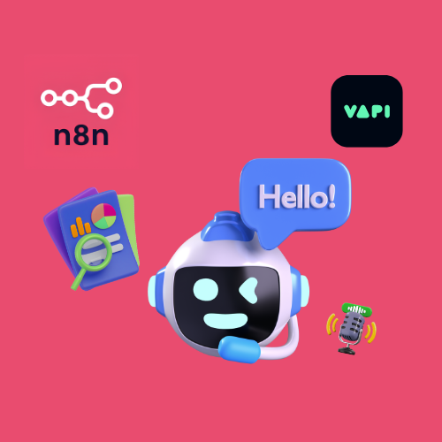
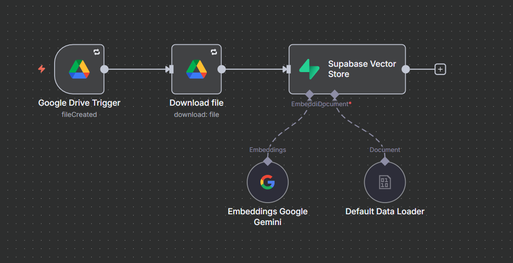
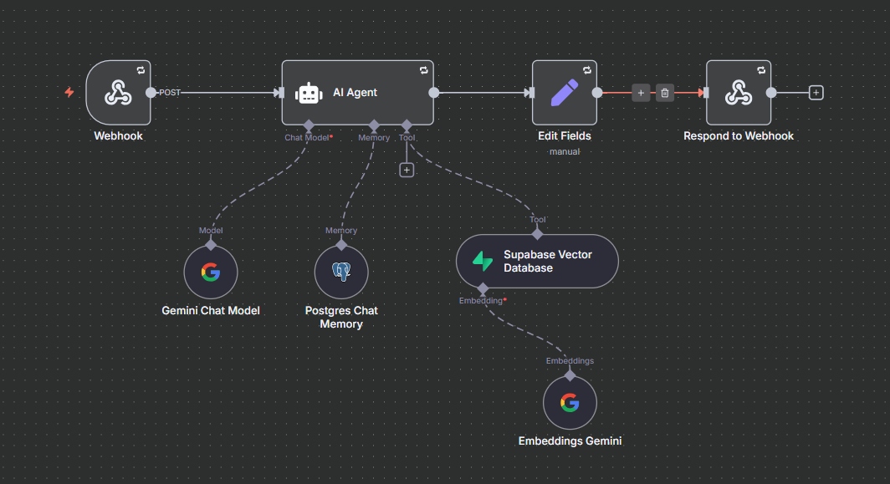

# Vapi Supabase Voice RAG Agent

An n8n workflow that answers Vapi voice-assistant questions from a Supabase vector knowledge base. It receives a tool call through a webhook and returns a one-sentence answer with a source citation.

## Overview

Vapi sends each spoken question to an n8n webhook as a tool call. An AI agent searches a Supabase vector store, reranks the matches with Cohere, and writes a single-sentence answer that cites its source. Postgres chat memory keeps recent exchanges, so follow-up questions resolve against earlier ones. The workflow returns the answer in the response format Vapi expects.

The screenshot below shows a document ingestion pipeline for the vector store. A Google Drive trigger fires when a file is created, the file is downloaded, and a Supabase Vector Store node receives it with Google Gemini embeddings and a default data loader.

## Workflows

| Workflow | Trigger | Purpose |
| --- | --- | --- |
| Vapi Supabase Voice RAG Agent | Webhook (POST) | Answers a spoken query from the Supabase knowledge base in one cited sentence. |

## Workflow Details

### Vapi Supabase Voice RAG Agent

This workflow turns a Vapi tool call into a retrieval-based answer and sends it back to Vapi.

**Trigger:** a Webhook node that accepts POST requests and holds the connection open until the Respond to Webhook node replies.

Execution steps:

1. The Webhook node receives the request.
2. The AI Agent reads the query from the tool call in the request body.
3. The agent loads the last 10 messages from the Postgres Chat Memory node.
4. The agent calls the Supabase Vector Database tool, which embeds the query with Embeddings Gemini and retrieves the top 10 matches.
5. The Reranker Cohere node reorders the matches by relevance.
6. The Gemini 2.5 Flash Chat Model writes the answer, and the Gemini 2.5 Flash Lite Chat Model serves as the fallback model.
7. A Set node named "Remove '"' from Output" strips double quotation marks from the answer.
8. The Respond to Webhook node returns JSON containing the tool call identifier and the answer.

Agent behavior is set by its system prompt:

- The answer is exactly one sentence followed by a source citation on a separate line.
- The agent uses only information retrieved from the vector store.
- When retrieval returns nothing, the agent replies that no relevant information was found in the knowledge base.
- The agent uses chat memory to resolve follow-up questions such as "Why did that happen?".

Branching and loops: the workflow has no branches, loops, or sub-workflow calls. The nodes run in a single line from the Webhook to the response.

Error handling: the workflow settings reference an error workflow. The Webhook, AI Agent, Set, and Respond to Webhook nodes have retry on failure enabled.

Integrations: Vapi, Supabase, Postgres, Google Gemini, Cohere.

## Integrations

- Vapi: sends the tool call and receives the answer.
- Supabase: stores the vector knowledge base searched by the agent.
- Postgres: stores chat memory.
- Google Gemini: provides the chat models and the embeddings.
- Cohere: reranks retrieved matches.
- Google Drive: triggers the ingestion pipeline and supplies its files.

## Prerequisites

- An n8n instance with the LangChain AI nodes available.
- A Google Gemini (PaLM) API credential.
- A Supabase API credential and a Supabase project with a vector table and a matching search function.
- A Postgres credential for chat memory.
- A Cohere API credential.
- A Vapi account configured to call the webhook as a tool.
- A Google Drive credential, required only for the ingestion pipeline.

## Setup

1. Import `Vapi_Supabase_Voice_RAG_Agent.json` from the `workflows` directory into n8n.
2. Create the Google Gemini (PaLM) API, Supabase API, Postgres, and Cohere API credentials in n8n.
3. Assign each credential to the matching node: the two Gemini chat models, Embeddings Gemini, Supabase Vector Database, Postgres Chat Memory, and Reranker Cohere.
4. Review the node parameters, including the vector table, the search function, and the memory session key.
5. Copy the production webhook URL from the Webhook node into the Vapi tool configuration.
6. Activate the workflow.
